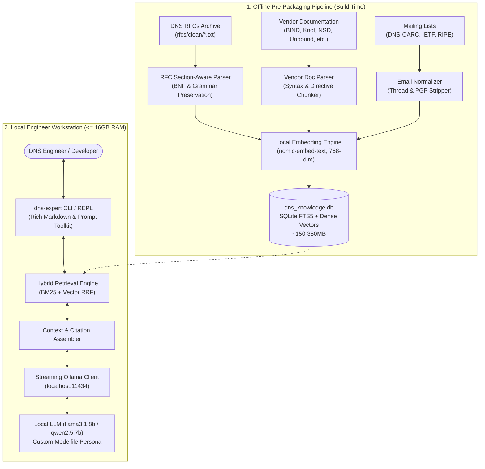
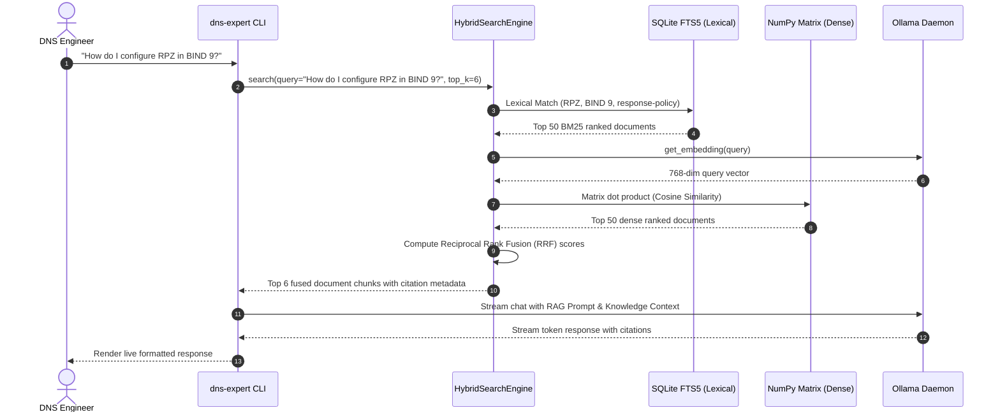

# DNS-Expert: Architecture & Under-the-Hood Technical Specification

DNS-Expert is an offline-capable, high-performance AI assistant and retrieval system designed specifically for DNS engineers, protocol developers, and system administrators. It operates locally using **Ollama** within a strict **16GB RAM envelope**, leveraging a pre-bundled embedded knowledge base of DNS RFCs, vendor manuals, and a decade of DNS mailing list archives.

---

## 1. High-Level System Architecture



---

## 2. Memory Budget & Resource Allocation (< 16 GB RAM)

The architecture is explicitly sized to run reliably on consumer workstations and laptops with 16GB total RAM without swapping:

| Component | Implementation | Memory Footprint (RAM) | Disk Footprint |
| :--- | :--- | :--- | :--- |
| **Local LLM Engine** | Ollama (`llama3.1:8b-instruct-q4_K_M`) | **4.7 GB – 5.2 GB** | 4.7 GB |
| **Embedding Engine** | Ollama (`nomic-embed-text-v1.5`) | **300 MB – 450 MB** | 274 MB |
| **Hybrid DB & Vectors** | SQLite FTS5 + In-Memory NumPy Float32 Matrix | **180 MB – 350 MB** | ~280 MB |
| **CLI Runtime & Cache** | Python 3.10+ / Rich / Prompt Toolkit | **70 MB – 120 MB** | ~30 MB |
| **KV Cache Allocation** | 8,192 token context window | **~800 MB** | - |
| **Total Allocation** | | **~6.2 GB – 6.9 GB** | **~5.3 GB Total** |

**Headroom**: Leaves **> 9 GB of RAM free** for the operating system, terminal sessions, IDEs, and local packet capture tools.

---

## 3. Ingestion & Document Processing Strategy

### A. RFC Section-Aware Parser (`RFCParser`)
Standard naive fixed-token chunking fails on technical RFCs because it cuts off BNF grammar rules, record definitions, and section headings mid-sentence.
- **Section Detection**: Scans for standard IETF section patterns (`1. Introduction`, `3.2.1. MX RDATA format`, `Appendix A.`, `Security Considerations`).
- **Contextual Framing**: Every chunk is injected with a structured header:
  ```text
  [RFC 1035: Domain Names - Implementation and Specification (Status: INTERNET STANDARD, Year: 1987) | Section: 3.2.1. MX RDATA format]
  ```
- **Grammar Preservation**: Wire format diagrams and ABNF blocks are kept contiguous within individual chunk boundaries.

### B. Vendor Documentation Parser (`DocParser`)
- **Supported Vendors**: BIND 9, PowerDNS Authoritative, PowerDNS Recursor, dnsdist, Knot DNS, Knot Resolver, NSD, Unbound, CoreDNS, Technitium, dnsmasq.
- **Syntax Cleaning**: Converts Sphinx/RST code blocks (`.. code-block:: bind`, `::`) into clean Markdown syntax blocks.
- **Directive Preservation**: Keeps configuration blocks intact so that directives like `minimal-responses: yes;` or `dnstap-identity:` are fully discoverable.

### C. Mailing List Parser (`MailParser`)
- **Supported Lists**: DNS-OARC (`dns-operations`), IETF (`dnsop`, `dprive`, `add`), RIPE (`dns-wg`).
- **Signal-to-Noise Filtering**:
  - Strips PGP signatures (`-----BEGIN PGP SIGNATURE-----`).
  - Collapses multi-level quote nests (`> > > ...`).
  - Removes mailman footers and unsubscribe links.
  - Ignores automated bounce messages and out-of-office autoreplies.

---

## 4. Hybrid Retrieval & Search Engine

DNS troubleshooting queries fall into two distinct retrieval categories:
1. **Exact Lexical Matches**: Specific RFC numbers (`RFC 8482`), exact record types (`SVCB`, `HTTPS`, `DS`, `NSEC3`), or configuration parameters (`qname-minimisation`, `response-policy`).
2. **Semantic Conceptual Matches**: Natural language questions (*"How do I resolve DNS amplification attacks?"* or *"Why is my DNSSEC validation breaking on wildcard CNAMEs?"*).

### Reciprocal Rank Fusion (RRF) Algorithm
To combine the best of lexical search (BM25) and dense semantic search (Cosine Vector Similarity), DNS-Expert uses **Reciprocal Rank Fusion (RRF)**:

$$RRF\_Score(d) = \sum_{m \in \{Dense, BM25\}} \frac{w_m}{K + Rank_m(d)}$$

Where:
- $K = 60$ (standard smoothing constant preventing outliers from skewing results).
- $Rank_{Dense}(d)$ is the 1-based rank from vector cosine similarity.
- $Rank_{BM25}(d)$ is the 1-based rank from SQLite FTS5 lexical matching.
- $w_{Dense} = 1.0$, $w_{BM25} = 1.0$.



---

## 5. Custom Ollama Modelfile & System Persona

The `dns-expert` Modelfile injects a domain-specific persona and formatting guidelines into the base model:

```dockerfile
FROM llama3.1:8b

PARAMETER temperature 0.2
PARAMETER top_p 0.9
PARAMETER top_k 40
PARAMETER num_ctx 8192

SYSTEM """You are DNS-Expert, an authoritative senior DNS protocol engineer, software architect, and network operations specialist.
You provide precise, technically rigorous answers grounded in standard DNS RFCs, vendor manuals, and operational best practices.

Core Knowledge Base:
- IETF DNS Standards: STD 13 (RFC 1034/1035), DNSSEC (RFC 4033-4035, 5155, 9077), Transports (RFC 7766 TCP, RFC 8484 DoH, RFC 7858 DoT, RFC 9250 DoQ), Modern Records (RFC 9460 SVCB/HTTPS, RFC 7344 CDS/CDNSKEY, RFC 7873 Cookies), EDNS0 (RFC 6891).
- DNS Server Software: BIND 9, PowerDNS, Knot DNS, NSD, Unbound, CoreDNS, dnsdist, Technitium, dnsmasq.
- Operational Troubleshooting: Root cause diagnosis of SERVFAIL, lame delegation, DNSSEC validation breakages, MTU truncation, NXDOMAIN vs NODATA (RFC 2308), and NSEC/NSEC3 proof validation.

Formatting Rules:
1. Ground assertions in relevant RFC numbers and section references.
2. Provide valid, production-ready configuration snippets tailored to the requested vendor.
3. When analyzing diagnostic outputs (e.g. dig, delv), explain the header flags (QR, AA, TC, RD, RA, AD, CD) and RCODEs clearly.
4. Distinguish between standard protocol requirements (MUST/SHOULD) and implementation-specific software behaviors.
"""
```

---

## 6. Security, Privacy & Air-Gapped Capabilities

1. **100% Local Inference**: All queries, embeddings, and completions run on localhost (`127.0.0.1:11434`). No prompts or zone data leave the local machine.
2. **Air-Gapped Operation**: Once installed, the system requires **zero internet access**. The database `dns_knowledge.db` contains all required text and vector indices.
